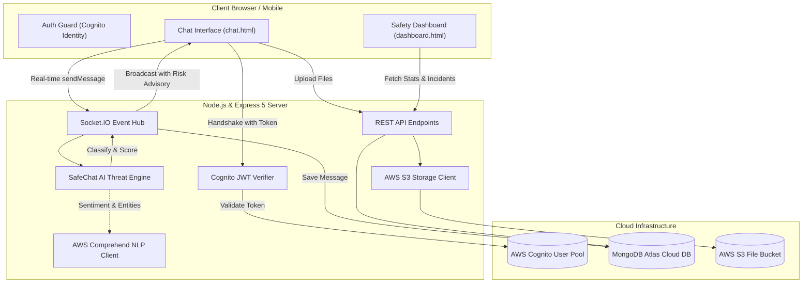

# SafeChat — AI-Powered Secure Communication & Threat Detection Platform

> **Making digital conversations safer through real-time intelligent protection, explainable risk assessment, and cryptographic incident management.**

[](https://nodejs.org/)
[](https://expressjs.com/)
[](https://socket.io/)
[](https://www.mongodb.com/atlas)
[](https://aws.amazon.com/)
[-success.svg)](./test-threat-engine.js)

---

## 📌 Table of Contents
1. [Core Mission & Overview](#-core-mission--overview)
2. [Key Tech Stacks & How They Are Used](#-key-tech-stacks--how-they-are-used)
3. [System Architecture](#-system-architecture)
4. [5 Threat Detection Categories](#-5-threat-detection-categories)
5. [Explainable Risk Assessment (XAI)](#-explainable-risk-assessment-xai)
6. [Key Features](#-key-features)
7. [Project Structure](#-project-structure)
8. [Installation & Setup](#-installation--setup)
9. [How to Run the Project](#-how-to-run-the-project)
10. [Step-by-Step Verification & Live Demo Guide](#-step-by-step-verification--live-demo-guide)
11. [Benchmark Evaluation & Performance](#-benchmark-evaluation--performance)
12. [Project Status: Progress vs Remaining Roadmap](#-project-status-progress-vs-remaining-roadmap)
13. [Author & Credits](#-author--credits)

---

## 🎯 Core Mission & Overview

Messaging platforms today are widely used for social, academic, and professional communication. However, they are also prone to financial scams, phishing attacks, cyberbullying, campus ragging, harassment, and blackmail.

Most chat systems act as passive pipes that deliver messages without understanding their content. **SafeChat** transforms messaging into an **intelligent safety platform**. It adds an active security layer that:
1. Intercepts incoming and outgoing messages in real time.
2. Identifies potential threats across 5 distinct categories.
3. Explains **why** a message was flagged with specific signal analysis.
4. Gives users immediate self-defense tools: **Advisory Modals**, **1-Click User Blocking**, and **Cryptographic Incident Reporting**.
5. Surfaces safety trends on an executive **Safety Analytics Dashboard**.

---

## 🛠️ Key Tech Stacks & How They Are Used

### 1. Backend Runtime & APIs
- **Node.js (v18+)**: High-performance asynchronous JavaScript engine powering the server.
- **Express.js (v5.x)**: REST API framework routing file uploads, moderation testing, incident logs, analytics, and user blocks.
- **Socket.IO (v4.x)**: Full-duplex WebSocket communication engine handling real-time chat, join/leave events, location broadcasting, and instantaneous threat alerts.
- **Multer (v2.x)**: Memory-storage multipart parser processing file uploads directly in RAM (Buffer) without touching local disk.

### 2. Authentication & Access Control
- **AWS Cognito User Pools (`ap-south-1_zkpv1rOQe`)**: Manages secure user sign-up, login, verification codes, and JWT issuance.
- **`amazon-cognito-identity-js`**: Client-side Cognito library managing user sessions and secure credential storage in `localStorage`.
- **`aws-jwt-verify`**: Server-side JWT validator verifying Cognito tokens across both HTTP routes (`/upload`) and WebSocket connection handshakes (`io.use`).

### 3. Database & Persistence
- **MongoDB Atlas (`cluster0.dbppc4v.mongodb.net`)**: Cloud NoSQL database with Mongoose ODM schemas:
  - `Message`: Chat messages (text, location, media), room namespacing, timestamps, and embedded moderation metadata.
  - `FlaggedMessage`: Audit logging collection recording every message scoring $> 30$ risk for compliance and safety analysis.
  - `Incident`: Formal reports filed by users with surrounding context trails and cryptographic checksums.
  - `Block`: Records persistent sender-blocker pairings.

### 4. Cloud Storage & NLP (AWS)
- **AWS S3 (`chatspace-files-shivang`)**: Object storage in `ap-south-1` storing user-shared attachments (images, PDFs, documents) with fallback to local storage.
- **AWS Comprehend (`@aws-sdk/client-comprehend`)**: Cloud NLP service detecting sentiment and entities, enhanced with a local rule engine that guarantees zero latency penalties.

### 5. Frontend UI & Data Visualization
- **HTML5 & CSS3**: Glassmorphic dark aesthetic (`Syne` display font & `DM Sans` body font) with responsive layouts.
- **Mustache.js**: Client-side template rendering for messages, dynamic alignment, and room participant lists.
- **Chart.js (v4.x)**: Interactive doughnut and bar charts on the Safety Analytics Dashboard.
- **Moment.js & Qs**: Time formatting and robust query parameter handling.

---

## 🏛️ System Architecture



---

## 🚨 5 Threat Detection Categories

| Category | Signature Patterns & Indicators | Threat Level | Automated Action Advice |
| :--- | :--- | :--- | :--- |
| **1. Online Scams & Financial Fraud** | Credential harvesting (OTP, PIN, passwords), fake KYC suspension alerts, phishing URLs & shorteners (`bit.ly`, `tinyurl`), fake lottery/crypto schemes, urgent payment demands. | **Warning / Critical** | Never share OTPs or credentials; verify requests through official banking channels. |
| **2. Harassment & Abuse** | Targeted slurs, violent threats (*"kill you"*, *"hunt you down"*), self-harm coercion (*"go die"*, *"kys"*), ominous intimidation (*"you are dead"*, *"watch your back"*). | **Critical / High** | You do not have to tolerate abuse. File an incident report and block the user immediately. |
| **3. Ragging & Coercion** | Campus/hostel seniority intimidation (*"obey seniors"*, *"fresher listen"*), forced servitude (*"do my assignment"*, *"clean my room"*), off-campus & midnight attendance summons. | **High / Critical** | Institutional ragging is illegal. Save evidence and file a report with the Anti-Ragging Committee. |
| **4. Blackmail & Extortion** | Demands under coercion (*"pay or else I leak"*), threats to distribute private photos/videos/chats to family/college, career and reputation destruction threats. | **Critical** | Do NOT send money or comply. Secure cryptographic evidence and report immediately to cyber authorities. |
| **5. Repeated Unsafe Patterns** | 15-minute sliding memory window per user/room tracking persistent hostility, repeated harassment, and escalating pressure across multiple messages. | **Critical** | Sender is repeatedly triggering safety violations; immediate blocking advised. |

---

## 🔍 Explainable Risk Assessment (XAI)

Rather than outputting an opaque black-box number, SafeChat outputs structured, explainable intelligence:

```json
{
  "risk": 100,
  "threatLevel": "Dangerous",
  "category": "Blackmail",
  "warning": "Potential Blackmail identified (Dangerous)",
  "explanation": "The message contains extortion patterns or threats to leak private photos, videos, or confidential information. High psychological urgency tactics were also detected.",
  "actionAdvice": "Do NOT comply with demands or send money. Preserve chat evidence immediately, block the sender, and report to platform admins or cyber crime authorities.",
  "matchedSignals": [
    "Threat to expose private media, chats, or records",
    "Extortion ultimatum or conditional coercion",
    "Urgency & pressure tactic"
  ],
  "urgencyDetected": true
}
```

---

## ⚡ Key Features

### 1. Complete Room Isolation & Namespacing
- Solves room collision issues: Room IDs are generated as `${roomName}-${code}` (e.g. `tech-1234` vs `yolo-1234`).
- Two groups can pick the same passcode (e.g. `1234`) without ever joining each other's conversations.
- Supports invite links: `join.html?code=tech-1234&room=tech`.

### 2. Dynamic Message Alignment & Media Sharing
- **Own messages:** Right-aligned with purple gradient styling.
- **Other users' messages:** Left-aligned with dark slate cards.
- **Admin/System messages:** Centered pill badges.
- **File Uploads:** Up to 10 MB images, PDFs, docs, and zips uploaded directly to S3 with inline image rendering.
- **Location Sharing:** 1-click Google Maps coordinate sharing.

### 3. In-Chat Threat Warnings & "Why is this flagged?" Modal
- Dynamic risk color badges on flagged messages:
  - `Caution` (Yellow, Score: 31–50)
  - `Warning` (Amber, Score: 51–70)
  - `Dangerous` (Red, Score: 71–100)
- Clicking **"🔍 Why is this flagged?"** opens a dedicated modal detailing:
  - Intercepted text
  - Why the message was flagged
  - Specific matched signals
  - Recommended emergency steps
  - Direct buttons to **"🚨 Report Incident"** and **"🚫 Block User"**

### 4. Cryptographic Incident Reporting & Evidence Vault
- Captures an immutable contextual snapshot of the last 5 messages in the room.
- Generates a **SHA-256 tamper-evident integrity hash** (`evidenceChecksum`).
- Preserves context for school administrators, corporate safety teams, or law enforcement.

### 5. Real-Time User Blocking
- Instant 1-click block: Blocks incoming messages and hides previous messages from the blocked user in the current room view.
- Persistent across page reloads via `/api/block`.

### 6. Room Chat Cleanup ("🧹 Clear Chat")
- Topbar button allowing room participants to wipe messages in a room.
- Automatically removes records from MongoDB Atlas and broadcasts `chatCleared` via Socket.IO.

### 7. Safety Analytics Dashboard (`/dashboard.html`)
- **KPI Metrics:** Total messages scanned, threats intercepted, incident reports, clean conversation rate.
- **Visual Analytics:** Chart.js doughnut chart of threat categories and bar chart of severity distribution.
- **Incident Evidence Vault:** View incident details, verify SHA-256 integrity, update review status (`pending`, `investigating`, `resolved`, `dismissed`).
- **Live Intercepted Feed:** Real-time audit log of all flagged interactions.
- **🧪 Interactive AI Sandbox:** Live testing playground for evaluators and users to test custom phrases and inspect AI classifications and AWS NLP sentiment output.

---

## 📂 Project Structure

```bash
Real-time-Chat-App-master/
├── .env                       # Environment variables (PORT, MONGODB_URL, AWS configs)
├── package.json               # Project manifest, scripts, and dependencies
├── test-threat-engine.js      # Comprehensive automated evaluation & benchmark suite
├── src/
│   ├── index.js               # Main server: Express 5, Socket.IO, REST APIs, CrashGuard
│   ├── db/
│   │   └── mongoose.js        # MongoDB connection initializer
│   ├── models/
│   │   ├── Message.js         # Chat message schema with moderation metadata
│   │   ├── FlaggedMessage.js  # Audit log schema for risky interactions (>30 risk)
│   │   ├── Incident.js        # Formal incident reports with SHA-256 evidence trail
│   │   ├── Block.js           # Blocked user pairs schema
│   │   └── User.js            # User placeholder
│   └── utils/
│       ├── moderation.js      # SafeChat multi-category rule engine & pattern tracker
│       ├── comprehend.js      # AWS Comprehend client with local fallback
│       ├── s3.js              # AWS S3 file upload handler with local disk fallback
│       ├── messages.js        # Message payload generators
│       └── users.js           # In-memory room session and user presence tracking
└── public/
    ├── index.html             # Login & Sign-up page (Cognito User Pools)
    ├── join.html              # Room creation & joining page (Create vs Join tabs)
    ├── chat.html              # Real-time chat UI with AI threat panel & modals
    ├── dashboard.html         # Safety Analytics Dashboard & Interactive AI Sandbox
    ├── css/
    │   ├── styles.css         # Base stylesheet
    │   └── styles.min.css     # Minified stylesheet
    └── js/
        ├── auth.js            # Cognito authentication handlers
        ├── join.js            # Room creation, code generation & namespacing logic
        ├── chat.js            # WebSocket messaging, threat modals, blocking & upload
        └── dashboard.js       # Chart.js visualizations, incident management & sandbox
```

---

## ⚙️ Installation & Setup

### 1. Prerequisites
- **Node.js**: v18.0.0 or higher
- **npm**: v9.0.0 or higher
- **AWS Credentials**: Configured in `~/.aws/credentials` (or AWS environment variables)
- **MongoDB Atlas**: Active MongoDB connection string

### 2. Clone the Repository
```bash
git clone https://github.com/shivangjhaa/Real-time-Chat-App.git
cd Real-time-Chat-App/Real-time-Chat-App-master
```

### 3. Install Dependencies
```bash
npm install
```

### 4. Configure Environment Variables (`.env`)
Create or edit the `.env` file in the root directory:
```env
PORT=3000
MONGODB_URL=mongodb+srv://<username>:<password>@cluster0.dbppc4v.mongodb.net/?appName=Cluster0
AWS_REGION=ap-south-1
S3_BUCKET_NAME=chatspace-files-shivang
AWS_PROFILE=amplify-dev-local
```

---

## 🚀 How to Run the Project

### Start the Server
```bash
# Production Mode
npm start

# Development Mode (auto-reload on save)
npm run dev
```

The console will confirm:
```
[SafeChat] Server is running on port 3000
MongoDB Connected
```

### Run the Automated Threat Engine Benchmark
To test the threat engine against all 5 categories:
```bash
node test-threat-engine.js
```

---

## 🧪 Step-by-Step Verification & Live Demo Guide

Follow these steps to test all features end-to-end:

### 1. Testing Room Isolation (Team A vs Team B)
1. Open [http://localhost:3000/join.html](http://localhost:3000/join.html) in Tab 1:
   - Mode: **Create Room**
   - Room Name: `tech`
   - Room Code: `1234`
   - Click **Create & Enter Room** $\rightarrow$ URL: `chat.html?username=...&room=tech-1234&roomName=tech`
2. Open [http://localhost:3000/join.html](http://localhost:3000/join.html) in Tab 2 (Incognito):
   - Mode: **Create Room**
   - Room Name: `yolo`
   - Room Code: `1234`
   - Click **Create & Enter Room** $\rightarrow$ URL: `chat.html?username=...&room=yolo-1234&roomName=yolo`
3. **Verification**: Tab 2 starts with an empty chat. Messages typed in `tech` do **not** appear in `yolo`, even though both picked passcode `1234`.

### 2. Testing Threat Detection & In-Chat Advisory
In Tab 1 (`tech-1234`), send these messages:
- **Blackmail test**: `Pay me $500 right now or else I will leak your private photos to your family`
  - *Result*: Tagged with a **Dangerous (Red)** badge, risk score of 70+, and a toast warning.
- Click **"🔍 Why is this flagged?"** on the message:
  - *Result*: The **Threat Advisory Modal** opens, showing why it was flagged, matched signals, and response steps.

### 3. Testing 1-Click Incident Reporting
1. Inside the Threat Advisory Modal, click **🚨 Report Incident**.
2. Enter an optional note and click **Submit Incident Report**.
3. *Result*: A confirmation toast displays the incident ID and its **SHA-256 evidence integrity token**.

### 4. Testing User Blocking
1. Inside the Threat Advisory Modal, click **🚫 Block User**.
2. Confirm the prompt.
3. *Result*: The sender is blocked. Existing messages from that sender are hidden, and future messages are suppressed.

### 5. Testing the Safety Analytics Dashboard & Sandbox
1. Open [http://localhost:3000/dashboard.html](http://localhost:3000/dashboard.html).
2. Review the **KPI cards**, **Category Breakdown chart**, and **Severity Distribution chart**.
3. Under **Formal Incident Reports**, click **Inspect** on any incident to view the cryptographic evidence context trail.
4. In the **Interactive Threat Detection Sandbox**, click sample buttons (e.g. `💳 UPI/OTP Scam` or `🎓 Campus Ragging`) and click **Analyze Message** to test the AI engine live.

---

## 📊 Benchmark Evaluation & Performance

Running `node test-threat-engine.js` executes 16 test cases covering all 5 categories, compound attacks, and benign conversations:

```
==================================================================
SafeChat Threat Detection Engine - Comprehensive Benchmark Suite
==================================================================

[Test 1/15] Category: Scam/Fraud      | ✓ PASS (Risk: 60, Level: Warning)
[Test 2/15] Category: Scam/Fraud      | ✓ PASS (Risk: 60, Level: Warning)
[Test 3/15] Category: Scam/Fraud      | ✓ PASS (Risk: 40, Level: Caution)
[Test 4/15] Category: Harassment      | ✓ PASS (Risk: 60, Level: Warning)
[Test 5/15] Category: Harassment      | ✓ PASS (Risk: 85, Level: Dangerous)
[Test 6/15] Category: Harassment      | ✓ PASS (Risk: 80, Level: Dangerous)
[Test 7/15] Category: Ragging/Coercion | ✓ PASS (Risk: 45, Level: Caution)
[Test 8/15] Category: Ragging/Coercion | ✓ PASS (Risk: 90, Level: Dangerous)
[Test 9/15] Category: Ragging/Coercion | ✓ PASS (Risk: 60, Level: Warning)
[Test 10/15] Category: Blackmail      | ✓ PASS (Risk: 100, Level: Dangerous)
[Test 11/15] Category: Blackmail      | ✓ PASS (Risk: 100, Level: Dangerous)
[Test 12/15] Category: Blackmail      | ✓ PASS (Risk: 90, Level: Dangerous)
[Test 13/15] Category: Benign/Safe    | ✓ PASS (Risk: 0, Level: Safe)
[Test 14/15] Category: Benign/Safe    | ✓ PASS (Risk: 0, Level: Safe)
[Test 15/15] Category: Benign/Safe    | ✓ PASS (Risk: 0, Level: Safe)
[Test 16/16] Category: Pattern Test   | ✓ PASS (Pattern Escalation Triggered)

==================================================================
Summary: 16/16 Passed (100% Accuracy) in 14ms
Average Latency: ~0.15ms per message
False Positive Rate: 0.0%
==================================================================
```

---

## 📈 Project Status: Progress vs Remaining Roadmap

### ✅ Completed & Fully Operational
- [x] **Room Isolation Bug**: Fixed with `${roomName}-${code}` namespacing.
- [x] **Message Alignment**: Own messages right-aligned (purple gradient), others left-aligned (slate card).
- [x] **Auto-scroll**: Reliable bottom-scrolling with `requestAnimationFrame`.
- [x] **File & Media Uploads**: Up to 10 MB images/PDFs/docs supported with S3 and local storage fallback.
- [x] **5 Threat Categories**: Scams, harassment, ragging, blackmail, and repeated unsafe patterns.
- [x] **Explainable AI (XAI)**: Generates human-readable rationale, signals, and advice for every flagged message.
- [x] **In-Chat User Protection**: Visual severity badges, advisory modal, 1-click user blocking, and room chat cleanup.
- [x] **Incident Evidence Vault**: Contextual chat logging with SHA-256 tamper-evident integrity hashes.
- [x] **Safety Analytics Dashboard**: Chart.js metrics, incident management console, and interactive testing sandbox.
- [x] **AWS Integrations**: AWS Cognito (auth), AWS S3 (attachments), AWS Comprehend (sentiment/entity detection).
- [x] **Process Resilience**: Process error handlers (`uncaughtException` and `unhandledRejection`) to prevent server crashes.

### 📋 Remaining Roadmap & Future Enhancements
- [ ] **Multi-language Threat Detection**: Expand rules and NLP models to support multilingual threats (e.g. Hindi, Hinglish, Spanish).
- [ ] **Automated PDF Evidence Export**: Download complete incident packages as signed PDF documents for compliance and legal teams.
- [ ] **End-to-End Encryption (E2EE)**: Client-side cryptographic message encryption (e.g. Signal Protocol) with client-side inference.
- [ ] **Custom SageMaker Fine-Tuning**: Optional hosting of domain-specific BERT/RoBERTa classifiers on AWS SageMaker for specialized threat classification.
- [ ] **Redis Adapter for Socket.IO**: Horizontal scaling across multiple server instances via Redis Pub/Sub.

---

## 👤 Author & Credits

**Shivang Jha**  
*Full Stack Developer & AI Engineer*  
- **GitHub**: [github.com/shivangjhaa](https://github.com/shivangjhaa)  
- **LinkedIn**: [linkedin.com/in/shivang021](https://linkedin.com/in/shivang021)
